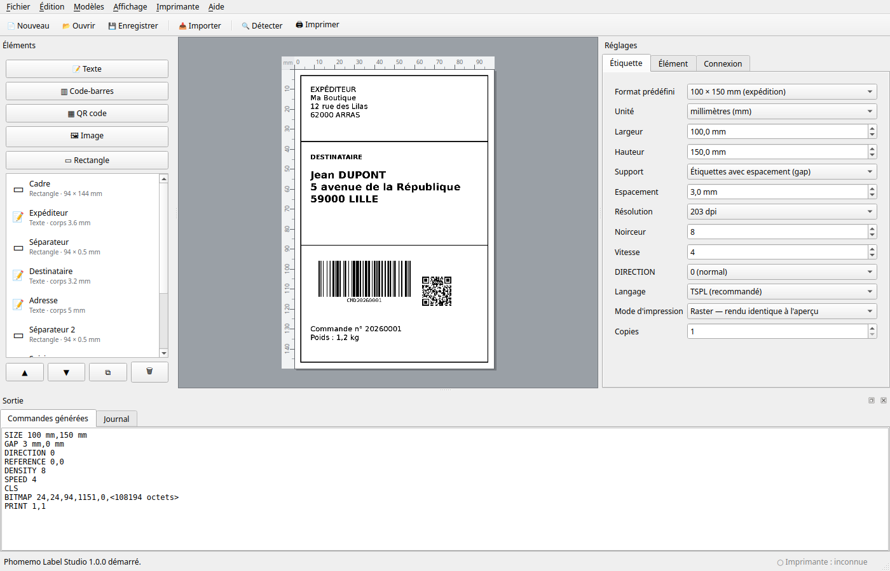
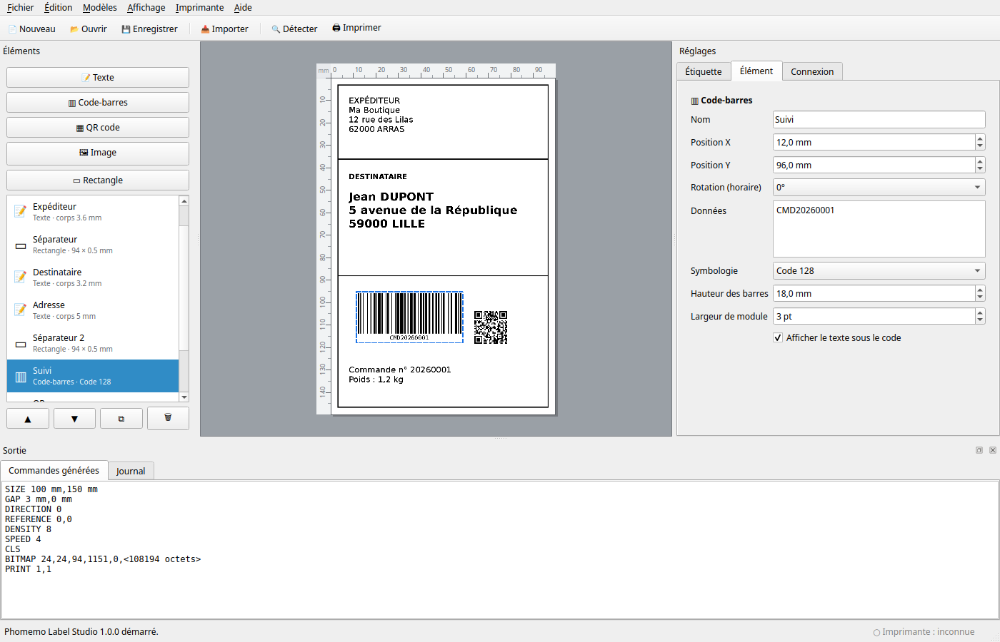
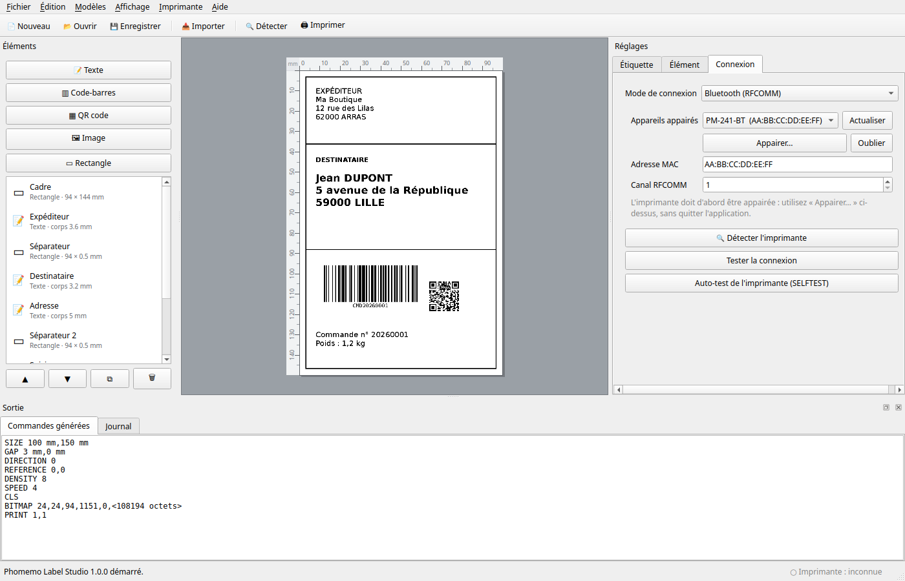
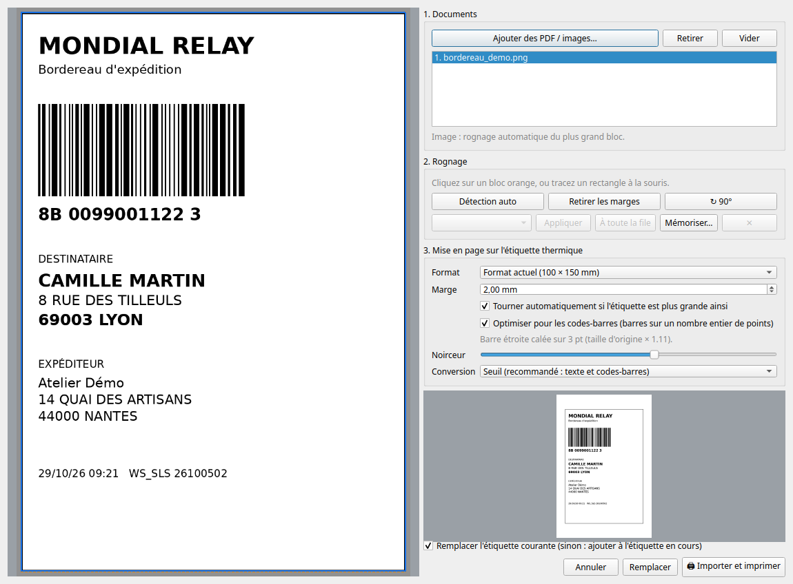

# Phomemo Label Studio

Application de bureau (Python + PyQt6) pour concevoir et imprimer des étiquettes thermiques
sur une **Phomemo PM-241-BT** sous **Linux Mint**, en TSPL (ou ZPL), **sans CUPS**.

## Fonctions

- **Connexion** : Bluetooth RFCOMM (sockets standard, adresse MAC), USB (`/dev/usb/lp0`), port série (`/dev/ttyUSB0`, `/dev/rfcomm0`…) ; **détection automatique de l'imprimante** (Bluetooth appairé, USB, série), **appairage et oubli d'un appareil Bluetooth depuis l'application**, bouton *Tester la connexion* (statut + modèle) et *Auto-test* (SELFTEST).
- **Éditeur visuel** : aperçu fidèle, éléments déplaçables à la souris (flèches du clavier : 0,5 mm, avec Maj : 2 mm), ordre des calques, duplication, zoom (Ctrl + molette).
- **Éléments** : texte (police, taille, gras/italique, alignement, multi-lignes), code-barres (Code 128, Code 39, EAN-13, EAN-8, UPC-A), QR code (4 niveaux de correction), images/logos (seuil, Floyd-Steinberg ou tramage de Bayer, inversion), rectangles et traits. Rotation 0/90/180/270° pour chacun.
- **Format** : formats prédéfinis (100×150 mm, 50×30 mm…) ou libre, en **mm ou en points**, 203/300 dpi, gap / repère noir / continu, noirceur, vitesse, copies.
- **Langages** : TSPL (par défaut) ou ZPL II, en deux modes :
  - **Raster** (recommandé) : l'étiquette est envoyée en une image `BITMAP` → rendu identique à l'aperçu, accents et polices TrueType compris.
  - **Natif** : `TEXT` / `BARCODE` / `QRCODE` / `BOX` (ZPL : `^A0` / `^B*` / `^BQ` / `^GB`) — très léger, mais limité aux polices internes de l'imprimante.
- **Import d'étiquettes de transport (Vinted, Leboncoin…)** : ouvre un bordereau PDF ou image, détecte et rogne l'étiquette, l'ajuste au format thermique (rotation automatique, marges, seuil noir/blanc pour garder des codes-barres lisibles) et l'imprime en un clic.
- Panneau « Commandes générées » (ce qui sera réellement envoyé), export `.tspl` / `.zpl`, export PNG, projets `.label.json` (images incluses), modèles prêts à l'emploi.

## Installation (Linux Mint 21/22)

```bash
sudo apt update
sudo apt install python3-venv python3-pip bluez libxcb-cursor0 libxkbcommon-x11-0 fonts-dejavu-core fontconfig

cd phomemo_label_studio
python3 -m venv .venv
.venv/bin/pip install -r requirements.txt
```

> `libxcb-cursor0` est indispensable à Qt ≥ 6.5 sous X11 (sinon : « Could not load the Qt platform plugin "xcb" »).
> Utilisez le Python **du système** (`/usr/bin/python3`) : c'est lui qui est compilé avec le support Bluetooth (`socket.AF_BLUETOOTH`). Un Python installé via pyenv/conda peut ne pas l'avoir.
> Pas besoin de PyBluez : il n'est plus maintenu et ne s'installe plus avec les Python récents.

Alternative sans pip pour PyQt : `sudo apt install python3-pyqt6` puis `python3 -m venv --system-site-packages .venv`.

## Lancer

```bash
./lancer.sh            # crée le venv au premier lancement, puis démarre l'application
# ou
.venv/bin/python main.py
```

## Tutoriel en images

### 1. Composer l'étiquette



L'application s'ouvre sur un modèle d'expédition 100 × 150 mm : cadre, expéditeur, destinataire, code-barres et QR code. À gauche, la liste des éléments — deux lignes par élément : son nom et, en gris, son type avec sa caractéristique (taille, symbologie, corps de police), précédés de l'icône du type (les flèches changent l'ordre, la corbeille supprime) et les boutons d'ajout ; au centre, l'aperçu fidèle, où les éléments se déplacent à la souris ; à droite, l'onglet **Étiquette** règle le support (format, gap, résolution, noirceur, vitesse, mode raster ou natif). En bas, **Commandes générées** montre exactement ce qui partira à l'imprimante.

Pour partir d'une page blanche : `Ctrl+N` puis **Format prédéfini** ; pour un autre modèle : menu **Modèles**.

### 2. Régler un élément



Cliquez sur un élément dans l'aperçu ou dans la liste : l'onglet **Élément** affiche ses réglages propres. Ici un code-barres Code 128 : données, symbologie, hauteur des barres, largeur de module et affichage du texte sous le code. Position et rotation se règlent au dixième de millimètre ; au clavier, les flèches déplacent de 0,5 mm (avec **Maj** : 2 mm), `Suppr` retire l'élément.

**Quadrillage.** Le menu **Affichage** propose *Afficher la grille* (`Ctrl+G`) — un quadrillage en millimètres sur l'aperçu, avec un trait plus marqué toutes les cinq mailles —, *Aligner sur la grille* (`Ctrl+Shift+G`) pour y accrocher les déplacements à la souris comme aux flèches, et le *Pas de la grille* (1, 2, 5 ou 10 mm). Le choix est mémorisé d'une session à l'autre. Le quadrillage n'existe qu'à l'écran : il ne figure jamais sur l'étiquette imprimée.

**Règles graduées.** Deux règles en millimètres encadrent l'aperçu, en haut et à gauche : elles donnent la position d'un élément sans passer par les champs de saisie. Leur pas suit le zoom — au millimètre quand on agrandit, au centimètre quand on dézoome — pour rester lisible ; le coin rappelle l'unité. Comme le quadrillage, elles sont purement visuelles et n'apparaissent jamais sur l'étiquette imprimée.

**Guides magnétiques.** Pendant un glisser, l'élément s'accroche aux bords et aux centres des autres éléments, ainsi qu'aux bords et au centre de l'étiquette ; une ligne orange en pointillés montre l'alignement retenu. Les trois repères de l'élément — bord de départ, centre, bord d'arrivée — sont candidats, dans les deux sens, et chaque axe s'aligne indépendamment : un élément peut se caler à gauche sur un voisin et au centre horizontalement sur l'étiquette. La tolérance suit le zoom (environ 6 px, plafonnée à 2 mm) : il suffit d'éloigner la souris pour ignorer un guide. Les guides se cumulent avec le quadrillage, qui arrondit d'abord la position. Maintenir **Alt** pendant le glisser suspend l'accrochage pour ce geste — les lignes disparaissent — ce qui permet de poser un élément juste à côté d'un autre sans être attiré.

**Annuler / rétablir.** `Ctrl+Z` revient sur le dernier geste, `Ctrl+Shift+Z` le refait : déplacements à la souris comme au clavier, réglages d'un élément, ajout, duplication, suppression et ordre de la liste, ainsi que les réglages d'étiquette. Les modifications rapprochées — frappe dans un champ, flèches maintenues — forment une seule étape, et l'élément sélectionné le reste quand il existe encore. Nouveau, ouvrir un fichier ou choisir un modèle repartent d'un historique vierge ; la pile conserve les cent derniers états. Les deux commandes sont dans le menu **Édition** et s'activent au fur et à mesure qu'il y a quelque chose à annuler ou à rétablir.

### 3. Connecter l'imprimante



Onglet **Connexion** : choisissez Bluetooth (avec la liste des appareils appairés), USB ou port série. **🔍 Détecter l'imprimante** (`Ctrl+D`) cherche et teste toute seule ; *Appairer…* associe une imprimante sans passer par le terminal, *Oublier* la retire de BlueZ. Le voyant en bas à droite indique en permanence si l'imprimante répond. Voir [Connecter l'imprimante](#connecter-limprimante) pour les détails et le dépannage.

### 4. Importer un bordereau Vinted / Leboncoin



`Ctrl+I` (ou glisser un PDF sur la fenêtre) ouvre cette boîte de dialogue : **1.** les documents en file d'attente, **2.** le rognage — automatique ici, avec la mention du bloc retenu — et **3.** la mise en page sur le rouleau. L'aperçu en bas montre le rendu final ; la case au-dessus choisit entre remplacer l'étiquette courante et y ajouter celle-ci, puis *Remplacer* charge le résultat dans l'éditeur et *Importer et imprimer* l'envoie directement. Plusieurs fichiers : le bouton devient **Imprimer les N étiquettes** et les envoie à la suite sur une seule connexion.

### 5. Imprimer

`Ctrl+P` (ou **🖨 Imprimer**) envoie l'étiquette affichée. Le **Journal** en bas rend compte du test de liaison et de l'envoi (`✔ Impression envoyée…`), et le voyant de la barre d'état confirme que l'imprimante répond. Les étiquettes se scannent toujours une première fois avant d'être collées : en cas de doute, ajustez *Noirceur* dans l'onglet **Étiquette**.

### Raccourcis

| Raccourci | Action |
|---|---|
| `Ctrl+N` / `Ctrl+O` / `Ctrl+S` | Nouveau / ouvrir un projet `.label.json` / enregistrer |
| `Ctrl+I` | Importer des étiquettes Vinted / Leboncoin |
| `Ctrl+P` | Imprimer l'étiquette affichée |
| `Ctrl+D` | Détecter l'imprimante |
| `Ctrl+0`, `Ctrl++`, `Ctrl+-` | Ajuster, zoomer, dézoomer (ou `Ctrl` + molette) |
| `Ctrl+G` / `Ctrl+Shift+G` | Afficher la grille / aligner les déplacements dessus |
| `Ctrl+Z` / `Ctrl+Shift+Z` | Annuler / rétablir la dernière modification |
| `Suppr` | Supprimer l'élément sélectionné |

## Tester

```bash
./tester.sh                 # crée le venv au besoin, installe les dépendances et lance les 147 tests
./tester.sh tests.test_ui   # seulement ces modules
./tester.sh -p test_ui.py   # seulement les fichiers correspondant au motif
```

Les tests d'interface tournent en mode Qt `offscreen` : aucun serveur graphique, aucune imprimante et aucune modification de votre configuration ne sont nécessaires. Le script renvoie le code de sortie de la suite (0 si tout passe), donc il s'enchaîne dans un hook ou une intégration continue.

**Avant chaque commit.** Le hook versionné `.githooks/pre-commit` lance les tests **concernés par les fichiers indexés** — seulement `tests.test_core` pour une modification de `printer.py`, par exemple — et **refuse le commit** si l'un échoue, en affichant la sortie complète. Une modification de documentation seule ne lance rien ; un module du socle partagé (`models.py`, `renderer.py`…), un fichier global (`requirements.txt`, `tester.sh`, le hook lui-même) ou une suppression de fichier déclenche toute la suite. `git commit --no-verify` permet de passer outre. Le hook s'active par `git config core.hooksPath .githooks`, déjà fait dans ce dépôt — à relancer après un nouveau clone.

## Régénérer les captures

```bash
./captures.sh               # les quatre images de docs/screenshots
./captures.sh import        # une seule (editeur, element, connexion, import)
```

Les captures du tutoriel sont produites **par l'application elle-même**, en Qt `offscreen`, pas fabriquées à la main : un changement d'interface se reflète donc en relançant le script. Il n'exige ni écran ni imprimante — `QSettings` pointe vers un dossier temporaire, la vérification périodique de l'imprimante est neutralisée et l'appareil Bluetooth affiché est fictif (`PM-241-BT`, `AA:BB:CC:DD:EE:FF`). Le bordereau de démonstration de la capture d'import est dessiné par le script : noms, adresses et numéro de suivi y sont inventés.

## Imprimer des étiquettes Vinted / Leboncoin

1. Téléchargez vos bordereaux (PDF) depuis Vinted ou Leboncoin.
2. Dans l'application : **Fichier → Importer des étiquettes Vinted / Leboncoin…** (Ctrl+I), ou **glissez un ou plusieurs PDF sur la fenêtre**. Chaque page de chaque PDF devient une entrée de la file d'attente.
3. Pour chaque entrée, l'étiquette est repérée automatiquement (cadre bleu). Sinon : cliquez sur un bloc orange, ou tracez un rectangle à la souris ; *Retirer les marges* resserre le cadre ; *↻ 90°* tourne d'un quart de tour de plus.

**Orientation.** Le texte de la zone rognée est analysé pour savoir dans quel sens l'étiquette a été dessinée : un bordereau couché ou à l'envers (fréquent chez Mondial Relay) est redressé automatiquement avant la mise à l'échelle, sans intervention. Seul le texte *à l'intérieur* du rognage compte — le mode d'emploi imprimé sur la page A4, lui, est toujours droit et ne fausse pas la mesure. Les images (PNG, JPG) n'ayant pas de texte, elles gardent l'orientation du fichier et se redressent avec *↻ 90°*.
4. Choisissez le format de votre rouleau (100 × 150 mm par exemple) ; l'aperçu en bas montre exactement ce qui sortira.
5. **Importer et imprimer** : avec une seule entrée, elle part directement ; avec plusieurs, **« Imprimer les N étiquettes »** les envoie à la suite sur une seule connexion Bluetooth, après confirmation. *Remplacer* / *Ajouter* chargent l'étiquette sélectionnée dans l'éditeur pour la retoucher (ajouter un texte, un n° de commande…).

**Reconnaissance du transporteur.** L'application lit le texte du PDF (Mondial Relay, Colissimo, Chronopost, Relais Colis, Vinted Go, DPD, GLS, UPS, DHL…, et Vinted / Leboncoin). Cliquez une fois sur **Mémoriser…** après avoir ajusté un rognage : il sera ensuite **appliqué automatiquement** à tous les PDF du même transporteur et du même format de page. Le message sous la liste dit ce qui a été reconnu et appliqué. *À toute la file* force un préréglage sur toutes les entrées. Les images (PNG, JPG) n'ont pas de texte : elles sont rognées automatiquement mais sans reconnaissance.

**Netteté des codes-barres.** Pour un PDF, la zone rognée est rendue *directement* à la résolution de l'imprimante (pas de réduction après coup). Avec « Optimiser pour les codes-barres » (activé par défaut), l'échelle est ajustée pour que la barre la plus fine tombe sur un nombre entier de points (par exemple 3 pt) : au maximum +3 % dans les marges ou −22 %. Si aucun calage ne convient, l'étiquette est laissée à son échelle naturelle ; le message sous la case l'indique. Si un code semble trop clair ou trop gras, réglez *Noirceur*. Scannez toujours le code du premier tirage avant de coller.

## Connecter l'imprimante

**Détection automatique.** Onglet **Connexion** → **🔍 Détecter l'imprimante** (ou menu *Imprimante*, Ctrl+D) : l'application cherche les appareils utilisables, retient le plus probable — une Phomemo reconnue à son nom **ou à sa classe Bluetooth** (`Imaging`, icône *printer*), sinon un port USB, puis un port série ou `rfcomm` — remplit la connexion et **teste aussitôt la liaison**. Le nom Bluetooth d'une imprimante ne dit pas toujours ce qu'elle est (`PM-241-BT`) : la classe et l'icône annoncées par l'appareil servent alors d'indice. Si une connexion valide est déjà configurée et que le candidat diffère, l'application **demande avant de la remplacer** (la connexion actuelle est proposée par défaut) ; refuser conserve la configuration en place, et une imprimante déjà constatée injoignable est remplacée sans question. Un appareil Bluetooth appairé qui n'est pas une imprimante (casque, enceinte…) est listé mais jamais retenu : mieux vaut aucun choix qu'un mauvais. Si l'imprimante est allumée mais pas encore appairée, un scan Bluetooth borné (quelques secondes) la signale — et c'est la raison pour laquelle elle **n'apparaît pas dans « Appareils appairés »**, qui ne liste que les appareils déjà appairés. L'application propose alors de l'appairer directement (avec le **Code PIN** mémorisé) ; en cas de refus, *Appairer…* permet de choisir l'appareil et le code à la main. Ce scan joint les appareils à portée à ceux que BlueZ connaît déjà (un appareil connu n'est pas réannoncé), et si la recherche ne donne rien il en explique la raison quand elle est connue : adaptateur éteint, aucun adaptateur, `bluetoothctl` absent.

**Appairage.** Onglet **Connexion** → *Appairer…* : l'application cherche les appareils à portée, met en avant celui qui ressemble à une imprimante, l'appaire puis l'approuve (*trust*) via BlueZ. Le code envoyé est celui du champ **Code PIN** (**0000** par défaut, parfois **1234** ; la dernière valeur est mémorisée) : avec 0000, BlueZ répond seul à l'imprimante ; avec un autre code, l'application le saisit quand l'imprimante le demande. Aucun terminal n'est nécessaire ; si l'appairage est refusé, le message rappelle le code envoyé, et l'appairage manuel ci-dessous reste possible.

**Oublier un appareil.** Toujours dans l'onglet **Connexion**, sélectionnez l'appareil appairé puis *Oublier* : après confirmation, il est retiré des appareils appairés de BlueZ, disparaît de la liste et la connexion Bluetooth est vidée (l'état repasse à *non configurée*). Utile après un changement de code PIN ou de modèle ; il faudra l'appairer de nouveau pour l'utiliser.

**État en continu.** La barre d'état affiche en permanence l'état de la liaison — **● Imprimante : joignable**, **injoignable** ou **non configurée** (le survol donne le détail de la dernière réponse). Elle est vérifiée toutes les minutes en arrière-plan, jamais pendant une impression, et remise à jour après chaque test ou envoi réussi.

### Bluetooth (RFCOMM)

1. Allumez l'imprimante, puis appairez-la **une fois** — avec le bouton *Appairer…* de l'application (plus haut) ou en ligne de commande :
   ```bash
   bluetoothctl
   power on
   scan on            # repérez « PM-241-BT » et son adresse AA:BB:CC:DD:EE:FF
   pair AA:BB:CC:DD:EE:FF
   trust AA:BB:CC:DD:EE:FF
   exit
   ```
   (Code PIN éventuel : `0000` ou `1234`.)
2. Dans l'application → onglet **Connexion** → *Bluetooth* : l'appareil apparaît dans « Appareils appairés » (sinon saisissez la MAC), canal RFCOMM **1** par défaut.
3. Fermez l'application mobile Phomemo et déconnectez le téléphone : l'imprimante n'accepte qu'un client à la fois.
4. Cliquez sur **Tester la connexion**.

Si la connexion est refusée alors que l'imprimante est allumée et appairée, essayez un autre canal (1 à 5) ; `sdptool browse AA:BB:CC:DD:EE:FF` (si disponible) liste le canal du service « Serial Port ». Variante équivalente : `sudo rfcomm bind 0 AA:BB:CC:DD:EE:FF 1` puis mode *Port série* sur `/dev/rfcomm0`.

### USB

Branchez le câble ; le périphérique apparaît en `/dev/usb/lp0` (ou `/dev/ttyUSB0` / `/dev/ttyACM0` selon le mode de l'imprimante). Droits d'accès :

```bash
sudo usermod -aG lp,dialout $USER    # puis fermer/rouvrir la session
```

## Utilisation rapide

1. Menu **Modèles** (bordereau 100×150, produit 50×30…) ou **Nouveau**, puis onglet **Étiquette** pour régler format, support (gap), noirceur.
2. Ajoutez des éléments avec les boutons **＋** à gauche ; sélectionnez-les (clic sur l'aperçu ou dans la liste) pour modifier leurs propriétés à droite.
3. Vérifiez le gap et le format correspondent à vos rouleaux, puis **🖨 Imprimer** (Ctrl+P).

## Structure du projet

```
main.py                     point d'entrée
lancer.sh                   lance l'appli (crée le venv au besoin)
requirements.txt
labelstudio/
  models.py                 Element / LabelSettings / Label (+ JSON)
  fonts.py                  résolution des polices TrueType (fontconfig)
  imaging.py                N&B, tramage, rotation, encodage binaire des bitmaps
  renderer.py               éléments -> bitmaps (aperçu ET impression raster) + géométrie native
  tspl.py / zpl.py          générateurs de trames
  printer.py                connexions Bluetooth RFCOMM / USB / série, test de statut
  importer.py               PDF/image -> blocs, rognage, rendu net 203 dpi, calage des barres, transporteur, préréglages
  templates.py              modèles d'étiquettes
  ui/                       canvas, panneaux Étiquette / Élément / Connexion, fenêtre principale
tests/                      110 tests : cœur, import, et interface hors écran (./tester.sh)
captures.sh                 régénère les captures du README
outils/captures.py          captures Qt hors écran, données fictives
.githooks/pre-commit        hook Git : lance les tests avant chaque commit
```

## Dépannage

| Symptôme | Piste |
|---|---|
| `Connexion refusée` (Bluetooth) | Téléphone encore connecté, mauvais canal, imprimante éteinte |
| `Permission refusée` (USB/série) | `sudo usermod -aG lp,dialout $USER` puis nouvelle session |
| Étiquettes décalées / une étiquette blanche en plus | Lancer la calibration du rouleau sur l'imprimante ; vérifier *Support* et *Espacement* |
| Impression trop claire / trop foncée | Onglet Étiquette → *Noirceur* |
| Image inversée / tête en bas | Onglet Étiquette → *DIRECTION* 0 ↔ 1 |
| Accents manquants en mode natif | Passer en mode **Raster** (polices internes limitées à CP1252) |
| Le test ne renvoie pas de statut | Normal sur certains firmwares : la liaison est établie, l'impression fonctionne quand même |

## Limites connues

- Écrit et testé sans imprimante physique : les trames et l'interface sont vérifiées (tests + rendu), mais le comportement exact de votre PM-241-BT (canal RFCOMM, DIRECTION, réponse au statut) est à confirmer sur le matériel.
- Si votre exemplaire n'expose pas de service Bluetooth « série » classique (certains modèles Phomemo sont BLE uniquement), utilisez l'USB.
- En mode natif, les rotations 90/180/270° et le ZPL natif reposent sur les conventions TSC/Zebra : en cas de décalage, le mode raster est exact.
